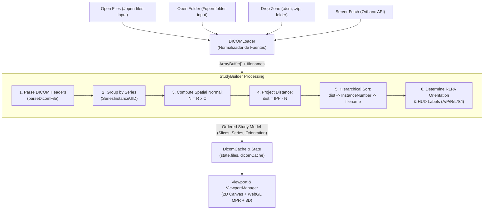

# Plan: Pipeline de Carga Unificado y Orientación Espacial DICOM (RLPA)

> **Spec:** `specs/004-study-loading/spec.md` · **Ticket:** US-49 / Core Loading Unification · **Date:** 2026-09-21

---

## Summary

Diseñar e implementar un **Pipeline de Carga Unificado** para el visor DICOM de MICD que erradique las divergencias actuales entre la carga de carpetas, archivos `.zip` y archivos individuales. La arquitectura desacopla la ingestión binaria del procesamiento de dominio médico introduciendo dos capas:

1. **`DICOMLoader`:** Capa de abstracción de entrada que normaliza cualquier fuente (archivos sueltos, carpetas vía `webkitdirectory`, archivos `.zip` comprimidos o instancias descargadas de Orthanc) en un flujo uniforme de buffers binarios (`ArrayBuffer`).
2. **`StudyBuilder`:** Motor matemático y de dominio DICOM que parsea metadatos, agrupa por series, realiza el ordenamiento espacial 3D estricto proyectando `ImagePositionPatient (0020,0032)` sobre el vector normal del plano ($\mathbf{N} = \mathbf{R} \times \mathbf{C}$ derivado de `ImageOrientationPatient (0020,0037)`), determina la orientación clínica canónica **RLPA** y calcula dinámicamente las etiquetas de orientación anatómica para el HUD del viewport.

---

## Constitution check

- **I. Local viewing is free:** La ingestión, descompresión, ordenamiento matemático y renderizado se ejecutan 100% en el cliente de forma offline y sin requerimiento de backend ni credenciales. ✅
- **II. Plain platform, no new dependencies:** Los cálculos geométricos (producto vectorial, producto escalar, proyecciones) se programan en TypeScript puro sin bibliotecas matemáticas pesadas. Se reutilizan únicamente `dicom-parser` y `fflate`. ✅
- **III. Desktop parity by vendoring:** Todo el código se localiza en `src/` de `web/`, listo para ser replicado en `desktop/src/renderer` vía `make sync-web`. ✅
- **IV. Bilingual by construction:** Mensajes de carga, errores de formato y etiquetas de orientación traducidos de forma idéntica en `src/i18n/locales/es.ts` y `src/i18n/locales/en.ts`. ✅
- **V. Accessibility (WCAG 2.2 AA):**
  - Anuncio en lector de pantalla (`aria-live="polite"`) de la cantidad de cortes cargados y ordenados.
  - Indicadores de orientación anatómica (`A`, `P`, `R`, `L`, `S`, `I`) con contraste accesible y atributos semánticos. ✅
- **VI. Security:** Sanitización de rutas relativas y nombres de archivos al descomprimir; manejo seguro de memoria al procesar grandes volúmenes de buffers. ✅
- **VII. Tests where it counts:** Pruebas unitarias completas DOM-free para el cálculo de normales, proyección de distancias, ordenamiento multi-criterio y resolución de orientación. ✅

---

## Auditoría de Código y Diagnóstico de Divergencias Actuales

El análisis minucioso de la base de código revela con exactitud los puntos de fallo que originan los tres comportamientos anómalos detectados:

### 1. ¿Por qué la Carga por Carpeta invierte la imagen ("de cabeza")?

- **Ignorancia de `ImageOrientationPatient (0020,0037)`:**
  - En [`src/dicom/dicom-parser-util.ts`](file:///home/drukdev/Desktop/Proyectos/FIUBA/TPP/repos/web/src/dicom/dicom-parser-util.ts#L163-L170), el tag `(0020,0037)` se parsea a `imageOrientationPatient: [Rx, Ry, Rz, Cx, Cy, Cz]`, pero **no es utilizado en ningún punto** de [`src/dicom/dicom-renderer.ts`](file:///home/drukdev/Desktop/Proyectos/FIUBA/TPP/repos/web/src/dicom/dicom-renderer.ts) ni [`src/viewer/rendering.ts`](file:///home/drukdev/Desktop/Proyectos/FIUBA/TPP/repos/web/src/viewer/rendering.ts).
  - El renderizado 2D (`renderMonochrome` y `ctx.putImageData`) asume ciegamente que la fila 0 de la matriz de píxeles siempre corresponde a la región Anterior del paciente y que las filas avanzan hacia Posterior. Si la orientación del paciente en la adquisición fue prono, pies primero, o con cosenos directores invertidos ($C_y < 0$), la imagen se dibuja invertida.
- **Historial de parches CSS en `applyCanvasTransform`:**
  - En el commit `1681a6d`, se introdujo un flip vertical forzado mediante CSS:
    `const transform = 'translate(...) scale(...) scaleY(-1)';`
  - En el commit `b3221d4` (`chore/fix-bugs`), este `scaleY(-1)` fue eliminado para simplificar la transformación, lo cual dejó desalineadas partes del sistema. Específicamente, [`src/viewer/measurements/measurement-math.ts`](file:///home/drukdev/Desktop/Proyectos/FIUBA/TPP/repos/web/src/viewer/measurements/measurement-math.ts#L110) y [`src/viewer/segmentation/segmentation-overlay.ts`](file:///home/drukdev/Desktop/Proyectos/FIUBA/TPP/repos/web/src/viewer/segmentation/segmentation-overlay.ts#L7) continúan asumiendo que `flipY: true` está activo.
- **Divergencia entre 2D y 3D en multi-corte:**
  - En [`src/viewer/loading.ts`](file:///home/drukdev/Desktop/Proyectos/FIUBA/TPP/repos/web/src/viewer/loading.ts#L211-L213), al cargar más de un archivo se llama a `loadVolumeIntoEngines()`. En [`src/viewer/view-3d.ts`](file:///home/drukdev/Desktop/Proyectos/FIUBA/TPP/repos/web/src/viewer/view-3d.ts#L1493-L1502), los cortes se ordenan por coordenada $Z$ (`posA[2] - posB[2]`), mientras que en 2D se ordenaron previamente por `instanceNumber` en [`src/viewer/loading.ts`](file:///home/drukdev/Desktop/Proyectos/FIUBA/TPP/repos/web/src/viewer/loading.ts#L65-L97). Si la numeración de instancias va de cabeza a pies y el eje $Z$ va de pies a cabeza, el corte 0 en 2D no coincide con la base del volumen tridimensional.

### 2. ¿Por qué la Carga por .ZIP carga los cortes desordenados?

- **Descompresión Asíncrona sin Garantía de Orden:**
  - En [`src/upload/zip-expand.ts`](file:///home/drukdev/Desktop/Proyectos/FIUBA/TPP/repos/web/src/upload/zip-expand.ts#L33-L45), `fflate.unzip` retorna un objeto `Record<string, Uint8Array>`. La iteración sobre `Object.entries(out)` depende de la implementación del motor JavaScript y del formato de compresión del archivo ZIP, el cual rara vez almacena los archivos en orden numérico estricto.
- **Ordenamiento Ficticio por Nombre en lugar de Geometría Espacial:**
  - En [`src/shared/folder-files.ts`](file:///home/drukdev/Desktop/Proyectos/FIUBA/TPP/repos/web/src/shared/folder-files.ts#L81-L92), `collectDicomFiles` ordena por nombre alfanumérico (`pathOf(a).localeCompare(...)`). En archivos ZIP de tomógrafos o PACS, los nombres suelen ser hashes o SOP Instance UIDs (ej. `1.2.840.113619...dcm`), donde la comparación léxica genera un orden caótico.
  - En [`src/viewer/loading.ts`](file:///home/drukdev/Desktop/Proyectos/FIUBA/TPP/repos/web/src/viewer/loading.ts#L65-L97), `sortFilesByInstanceNumber` intenta ordenar por `InstanceNumber (0020,0013)`. Sin embargo:
    - Muchos datasets omiten el tag `InstanceNumber` o asignan el mismo valor a varios cortes.
    - Si `InstanceNumber` falla, recurre a `file.name.localeCompare()`.
    - Nunca se evalúa la posición física real en el espacio del paciente (`ImagePositionPatient`).

### 3. ¿Por qué el Archivo Suelto funciona distinto?

- Al cargarse un único archivo (`selected.length === 1`), `sortFilesByInstanceNumber` retorna de inmediato sin procesar nada.
- La condición `if (sortedFiles.length > 1)` en [`src/viewer/loading.ts`](file:///home/drukdev/Desktop/Proyectos/FIUBA/TPP/repos/web/src/viewer/loading.ts#L211) saltea por completo la construcción de volúmenes (`loadVolumeIntoEngines()`).
- Al no haber cortes anteriores ni posteriores, el usuario no experimenta problemas de ordenamiento, lo que crea la falsa percepción de que el archivo suelto "funciona bien", aun cuando su orientación también pueda ignorar los cosenos directores.

---

## Arquitectura del Nuevo Pipeline Unificado

El siguiente diagrama ilustra el flujo propuesto donde todas las entradas convergen en el mismo proceso:



---

## Diseño Técnico Detallado

### 1. Módulo `src/dicom/spatial-math.ts` (Nuevo)

Motor matemático puro y testeable sin DOM para geometría espacial médica:

- **Vector Normal de Corte:**
  $$\mathbf{R} = [R_x, R_y, R_z], \quad \mathbf{C} = [C_x, C_y, C_z]$$
  $$\mathbf{N} = \mathbf{R} \times \mathbf{C} = \begin{bmatrix} R_y C_z - R_z C_y \\ R_z C_x - R_x C_z \\ R_x C_y - R_y C_x \end{bmatrix}$$
- **Proyección de Posición (Slice Distance along Normal):**
  $$d = \mathbf{IPP} \cdot \mathbf{N} = IPP_x N_x + IPP_y N_y + IPP_z N_z$$
- **Cálculo de Etiquetas Anatómicas del HUD:**
  Se evalúa la componente dominante de $\mathbf{R}$ (eje horizontal de la imagen) y $\mathbf{C}$ (eje vertical de la imagen) para determinar qué letra anatómica corresponde a cada borde:
  - Componente $X$: $+X \to \text{L (Left)}, -X \to \text{R (Right)}$.
  - Componente $Y$: $+Y \to \text{P (Posterior)}, -Y \to \text{A (Anterior)}$.
  - Componente $Z$: $+Z \to \text{S (Superior)}, -Z \to \text{I (Inferior)}$.
  - Borde Izquierdo: opuesto a la dirección $\mathbf{R}$.
  - Borde Derecho: dirección $\mathbf{R}$.
  - Borde Superior: opuesto a la dirección $\mathbf{C}$.
  - Borde Inferior: dirección $\mathbf{C}$.
- **Detección de Inversión Canónica (RLPA):**
  Función `getCanonicalTransform(R, C)` que calcula si la imagen requiere inversión horizontal o vertical para cumplir con la presentación médica estándar (Anterior arriba, Posterior abajo, Derecha a la izquierda de la pantalla, Izquierda a la derecha).

### 2. Módulo `src/dicom/study-builder.ts` (Nuevo)

Responsable de coordinar el parseo y ordenamiento estructurado:

```ts
export interface OrderedSlice {
  index: number;
  buffer: ArrayBuffer;
  parsed: ParsedDicom;
  projectedDistance: number | null;
  instanceNumber: number | null;
  fileName: string;
}

export interface OrderedSeries {
  seriesInstanceUid: string;
  seriesNumber: number | null;
  modality: string;
  slices: OrderedSlice[];
  planeNormal: [number, number, number] | null;
  orientationLabels: {
    top: string;
    bottom: string;
    left: string;
    right: string;
  };
  needsFlipY: boolean;
  needsFlipX: boolean;
}

export interface BuiltStudy {
  studyInstanceUid: string;
  patientName: string;
  seriesList: OrderedSeries[];
}

export async function buildStudyFromBuffers(
  inputs: Array<{ name: string; buffer: ArrayBuffer }>,
): Promise<BuiltStudy>;
```

### 3. Refactor de `src/viewer/loading.ts`

- Eliminar la lógica redundante y dispersa de ordenamiento en `sortFilesByInstanceNumber`.
- Reducir `loadLocalFiles(selected: File[])` a:
  1. Extraer buffers de los archivos y zips (vía `expandFiles`).
  2. Llamar a `buildStudyFromBuffers`.
  3. Poblar `dicomCache` y `state` con la serie primaria ordenada.
  4. Sincronizar simultáneamente el visor 2D y los motores volumétricos (`loadVolumeIntoEngines`) compartiendo la misma secuencia espacial.
- Reducir `loadStudyFromServer(studyId: string)` a:
  1. Descargar instancias como buffers.
  2. Pasarlas por `buildStudyFromBuffers`.
  3. Garantizar que los estudios remotos se ordenen con la misma lógica que los locales.

### 4. Ajustes en `src/dicom/dicom-renderer.ts` y `measurement-math.ts`

- Aplicar las correcciones de orientación (`needsFlipX`, `needsFlipY`) explícitamente en el pipeline de renderizado o en la matriz de visualización.
- Alinear `worldToScreen` y `screenToWorld` para que usen la orientación anatómica calculada del corte activo y no un parámetro `flipY: true` cableado en el código.

---

## Plan de Ejecución por Fases

### Fase 1: Motor Matemático Espacial (`spatial-math.ts`)

- Implementar producto vectorial ($\mathbf{N} = \mathbf{R} \times \mathbf{C}$), producto escalar ($\mathbf{IPP} \cdot \mathbf{N}$) y normalización.
- Implementar clasificador de orientación anatómica para etiquetas dinámicas HUD (A, P, R, L, S, I).
- Desarrollar suite completa de pruebas unitarias (`spatial-math.test.ts`) con fixtures DICOM conocidos (axiales supino/prono, coronales, sagitales).

### Fase 2: Motor de Dominio (`study-builder.ts`)

- Implementar `buildStudyFromBuffers` agrupando por series y ordenando por distancia proyectada con fallbacks (`instanceNumber` y nombre).
- Crear tests unitarios (`study-builder.test.ts`) simulando:
  - Cortes desordenados provenientes de un ZIP.
  - Slices sin `instanceNumber`.
  - Estudios de un solo corte.
  - Varios estudios o series combinadas en una misma carpeta.

### Fase 3: Unificación de Flujos de Carga en `loading.ts`

- Refactorizar `loadLocalFiles` para delegar la preparación a `study-builder.ts`.
- Refactorizar `loadStudyFromServer` para ordenar instancias de Orthanc bajo la misma regla geométrica.
- Actualizar `dicomCache` y `state` para consumir los cortes ordenados canónicamente.

### Fase 4: Renderizado y Orientación Canónica (RLPA)

- Integrar las transformaciones de orientación en `dicom-renderer.ts` y `ViewportManager`.
- Reemplazar las funciones estáticas `updateOrientationLabels()` por la versión dinámica basada en los metadatos de la imagen.
- Ajustar `measurement-math.ts` para mantener 100% de precisión en el overlay de mediciones y marcadores manuales (US-48).

### Fase 5: QA Global y Validación Integral

- Ejecutar `npm test` verificando cero regresiones en los 846 tests existentes.
- Ejecutar validación con linter y pre-commit (`make test` o `/qa-global`).
- Validar visualmente en navegador la carga por Carpeta, ZIP y Archivo único.

---

## Archivos a Modificar / Crear

| Acción        | Archivo                                       | Propósito                                                                                 |
| ------------- | --------------------------------------------- | ----------------------------------------------------------------------------------------- |
| **Crear**     | `src/dicom/spatial-math.ts`                   | Matemática de proyección sobre la normal, producto cruz, dot product y cálculo de HUD.    |
| **Crear**     | `src/dicom/spatial-math.test.ts`              | Tests unitarios puros para toda la matemática espacial.                                   |
| **Crear**     | `src/dicom/study-builder.ts`                  | Construcción de estudio estructurado, agrupación de series y ordenamiento jerárquico.     |
| **Crear**     | `src/dicom/study-builder.test.ts`             | Tests unitarios de ordenamiento agnóstico de fuente (ZIP, carpeta, archivos).             |
| **Modificar** | `src/viewer/loading.ts`                       | Unificación de entradas (carpeta, zip, archivo, servidor) convergiendo en `StudyBuilder`. |
| **Modificar** | `src/dicom/dicom-renderer.ts`                 | Soporte de orientación canónica RLPA sin flips mágicos en CSS.                            |
| **Modificar** | `src/viewer/rendering.ts`                     | Actualización dinámica de etiquetas de orientación (HUD).                                 |
| **Modificar** | `src/viewer/viewport-manager.ts`              | Actualización dinámica de etiquetas de orientación en celdas de grid.                     |
| **Modificar** | `src/viewer/measurements/measurement-math.ts` | Coordinación de `screenToWorld` con la orientación real del corte.                        |
| **Modificar** | `specs/README.md`                             | Registro de la especificación 004 en el índice del proyecto.                              |
