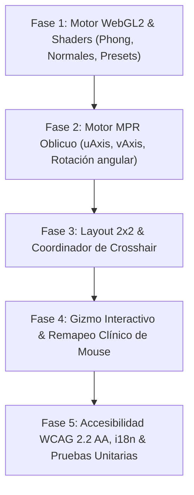

# Plan: [US-50] Mejoras 3D y MPR Oblicuo con Grilla 2x2 y Calidad Clínica

> **Spec:** `specs/006-mpr-oblique-ux/spec.md` · **Ticket:** US-50 / 3D & Oblique MPR Clinical Overhaul · **Date:** 2026-10-04

---

## Summary

Este plan técnico establece la arquitectura y la estrategia de implementación para evolucionar el visor DICOM de MICD desde su actual renderizador secuencial monocanal hacia una **Estación de Trabajo Radiológica Avanzada**. La solución integra:

1. **Grilla Clínica 2×2 Sincronizada:** Desacople del viewport único hacia 4 cuadrantes coordinados (Axial, Coronal, Sagital y 3D Volumétrico) con manipulación de Crosshairs vinculada.
2. **Reconstrucción Multiplanar Oblicua (_Oblique MPR_):** Parametrización vectorial dinámica $(\mathbf{u}', \mathbf{v}', \mathbf{n}')$ que permite cortes diagonales interactivos con muestreo trilineal a 60 FPS.
3. **Iluminación de Superficie Blinn-Phong en Raymarching:** Estimación de normales en tiempo real por diferencias finitas centrales sobre la textura volumétrica 3D (`gl.TEXTURE_3D`), acompañada de presets tisulares diagnósticos (_Bone_, _Soft Tissue_, _MIP_).
4. **Cubo de Orientación Anatómica (Gizmo) Interactivo:** Hit-testing 2D de polígonos frontales para snap/animación de cámara y corrección de contraste no textual bajo WCAG 1.4.11.
5. **Ergonomía Clínica de Mouse y Feedback Progresivo:** Adopción del estándar internacional (Izq: Órbita/Corte, Der: W/L continuo, Central: Pan sin bloqueos) e indicador de decodificación incremental `X / N cortes`.

---

## Constitution Check

- **I. Local viewing is free:** La reconstrucción ortogonal, oblicua y volumétrica opera íntegramente en el cliente mediante WebGL2 y memoria local (`Uint8Array`/`Int16Array`), sin dependencias de procesamiento remoto ni credenciales. ✅
- **II. Plain platform, no new dependencies:** Se implementan las operaciones tensoriales, álgebra lineal 3D (Matrix4, Vector3) y raymarching en TypeScript puro y GLSL ES 3.00, sin incorporar bibliotecas externas (Three.js, Cornerstone3D, VTK). ✅
- **III. Desktop parity by vendoring:** Toda la lógica de interacción y renderizado se aloja en `src/`, garantizando compatibilidad idéntica al replicarse en `desktop/src/renderer/` vía Electron. ✅
- **IV. Bilingual by construction:** Toda nueva clave (`viewer.mpr.layout2x2`, `viewer.mpr.presetBone`, `viewer.mpr.obliqueReset`, etc.) se incorpora con equivalencia exacta en `src/i18n/locales/es.ts` y `en.ts`. ✅
- **V. Accessibility (WCAG 2.2 AA):**
  - Controles semánticos con `role="radiogroup"`, `role="slider"` y atributos `aria-*`.
  - Contraste no textual superior a 3:1 en aristas del Gizmo y bordes de cuadrantes.
  - Anuncio por voz del avance de decodificación y cortes activos. ✅
- **VI. Security:** Sin ejecución de `eval`, shaders parametrizados estrictamente por uniforms y aislamiento de buffers en GPU. ✅
- **VII. Tests where it counts:** Pruebas unitarias DOM-free para transformaciones oblicuas, cálculo de gradientes y sincronización de crosshairs. ✅

---

## 1. Viabilidad y Arquitectura del Modelo Phong en el Fragment Shader

### 1.1 Diagnóstico de Viabilidad Técnica

El fragment shader actual de Raymarching ([src/viewer/mpr.ts#L421-L470](file:///home/drukdev/Desktop/Proyectos/FIUBA/TPP/repos/web/src/viewer/mpr.ts#L421-L470)) realiza acumulación alfa acumulando muestras equidistantes:
`accumColor.rgb += (1.0 - accumColor.a) * planeColor * planeAlpha;`

**La inyección del modelo de iluminación es 100% viable en WebGL2** sin sobrecargar la GPU:

- Las texturas 3D con filtrado trilineal (`gl.LINEAR`) permiten evaluar derivadas espaciales continuas.
- El cálculo del gradiente solo se evalúa para muestras cuya densidad supere el umbral de visibilidad de la función de transferencia (evitando cálculos en vóxeles transparentes como aire o ruido de fondo).
- Un paso de muestreo de $h = (1.0 / \text{dim}_x, 1.0 / \text{dim}_y, 1.0 / \text{dim}_z)$ asegura gradientes suaves y estables.

### 1.2 Cálculo de Normales por Diferencias Finitas Centrales (GLSL ES 3.00)

```glsl
vec3 computeGradient(sampler3D vol, vec3 texCoord, vec3 stepSize) {
    float dx = texture(vol, texCoord + vec3(stepSize.x, 0.0, 0.0)).r -
               texture(vol, texCoord - vec3(stepSize.x, 0.0, 0.0)).r;
    float dy = texture(vol, texCoord + vec3(0.0, stepSize.y, 0.0)).r -
               texture(vol, texCoord - vec3(0.0, stepSize.y, 0.0)).r;
    float dz = texture(vol, texCoord + vec3(0.0, 0.0, stepSize.z)).r -
               texture(vol, texCoord - vec3(0.0, 0.0, stepSize.z)).r;
    return vec3(dx, dy, dz);
}
```

### 1.3 Ecuación de Iluminación Blinn-Phong en Raymarching

Para cada paso del rayo:

1. Extraer gradiente: $\mathbf{G} = \text{computeGradient}(u\_volume, \text{texCoord}, u\_stepSize)$.
2. Si $\|\mathbf{G}\| > 0.005$:
   $$\mathbf{N} = -\text{normalize}(\mathbf{G})$$
   $$\mathbf{V} = -\text{rayDir}, \quad \mathbf{L} = \text{normalize}(\mathbf{V} + \text{vec3}(0.2, 0.3, 0.5)), \quad \mathbf{H} = \text{normalize}(\mathbf{L} + \mathbf{V})$$
   $$I_{diffuse} = \max(\mathbf{N} \cdot \mathbf{L}, 0.0)$$
   $$I_{specular} = \text{pow}(\max(\mathbf{N} \cdot \mathbf{H}, 0.0), 32.0)$$
   $$\text{color}_{shaded} = \text{baseColor} \cdot (k_a + k_d \cdot I_{diffuse}) + k_s \cdot I_{specular}$$

### 1.4 Estructura de Transfer Functions (Presets Diagnósticos)

Se introduce el uniform `uniform int u_presetMode;`:

- **Modo 0 (Grayscale Clásico):** Modulación de opacidad por Window/Level estándar.
- **Modo 1 (Bone Preset):** Curva de transferencia rampa en HU [150..1200], color base marfil `vec3(0.92, 0.88, 0.78)`, alta componente especular ($k_s = 0.4$).
- **Modo 2 (Soft Tissue Preset):** Piel en HU [-200..0] con $k_d = 0.8$ (rosa pálido, $\alpha = 0.15$), músculo en HU [20..100] (rojo parduzco, $\alpha = 0.4$), hueso opaco ($\alpha = 0.95$).
- **Modo 3 (MIP - Maximum Intensity Projection):**
  En lugar de acumulación alfa de frente hacia atrás, se ejecuta:
  ```glsl
  float maxVal = 0.0;
  for (int i = 0; i < STEPS; i++) {
      float d = texture(u_volume, texCoord).r;
      if (d > maxVal) maxVal = d;
      rayPos += stepVec;
  }
  fragColor = vec4(vec3(clamp((maxVal - minW) / u_windowWidth, 0.0, 1.0)), 1.0);
  ```

---

## 2. Estrategia de Sincronización de la Grilla 2×2

### 2.1 Estructura del DOM y CSS Grid

El contenedor `#viewport-container` se reemplaza o adapta dinámicamente según el modo de operación:

```html
<!-- Modo MPR Grilla 2x2 -->
<div
  class="mpr-grid-container"
  id="mpr-grid-container"
  role="region"
  aria-label="Estación de trabajo MPR 2x2"
>
  <!-- Viewport Axial (Top-Left) -->
  <div
    class="mpr-viewport mpr-viewport--axial active"
    id="vp-axial"
    tabindex="0"
    data-plane="axial"
  >
    <div class="mpr-viewport-header">
      <span class="mpr-viewport-title" data-i18n="viewer.mpr.axial">Axial</span>
      <span class="mpr-viewport-slice-info" id="vp-axial-info"
        >Corte 64/128</span
      >
      <button class="mpr-btn-maximize" aria-label="Maximizar corte axial">
        ⛶
      </button>
    </div>
    <canvas id="canvas-mpr-axial" class="mpr-canvas"></canvas>
    <div class="mpr-orient-labels">...</div>
  </div>

  <!-- Viewport Sagital (Top-Right) -->
  <div
    class="mpr-viewport mpr-viewport--sagittal"
    id="vp-sagittal"
    tabindex="0"
    data-plane="sagittal"
  >
    <div class="mpr-viewport-header">
      <span class="mpr-viewport-title" data-i18n="viewer.mpr.sagittal"
        >Sagital</span
      >
      <span class="mpr-viewport-slice-info" id="vp-sagittal-info"
        >Corte 120/256</span
      >
      <button class="mpr-btn-maximize" aria-label="Maximizar corte sagital">
        ⛶
      </button>
    </div>
    <canvas id="canvas-mpr-sagittal" class="mpr-canvas"></canvas>
    <div class="mpr-orient-labels">...</div>
  </div>

  <!-- Viewport Coronal (Bottom-Left) -->
  <div
    class="mpr-viewport mpr-viewport--coronal"
    id="vp-coronal"
    tabindex="0"
    data-plane="coronal"
  >
    <div class="mpr-viewport-header">
      <span class="mpr-viewport-title" data-i18n="viewer.mpr.coronal"
        >Coronal</span
      >
      <span class="mpr-viewport-slice-info" id="vp-coronal-info"
        >Corte 128/256</span
      >
      <button class="mpr-btn-maximize" aria-label="Maximizar corte coronal">
        ⛶
      </button>
    </div>
    <canvas id="canvas-mpr-coronal" class="mpr-canvas"></canvas>
    <div class="mpr-orient-labels">...</div>
  </div>

  <!-- Viewport 3D Volumétrico (Bottom-Right) -->
  <div
    class="mpr-viewport mpr-viewport--3d"
    id="vp-3d"
    tabindex="0"
    data-plane="3d"
  >
    <div class="mpr-viewport-header">
      <span class="mpr-viewport-title" data-i18n="viewer.mpr.3d"
        >3D Volumen</span
      >
      <button class="mpr-btn-maximize" aria-label="Maximizar vista 3D">
        ⛶
      </button>
    </div>
    <canvas id="canvas-mpr-3d" class="mpr-canvas"></canvas>
    <canvas
      id="mpr-reference-cube"
      class="mpr-cube-overlay"
      width="100"
      height="100"
    ></canvas>
  </div>
</div>
```

```css
.mpr-grid-container {
  display: grid;
  grid-template-columns: 1fr 1fr;
  grid-template-rows: 1fr 1fr;
  width: 100%;
  height: 100%;
  gap: 2px;
  background-color: var(--border, #1a1a24);
}

.mpr-viewport {
  position: relative;
  overflow: hidden;
  background: #000;
  display: flex;
  flex-direction: column;
}

.mpr-viewport.active {
  box-shadow: inset 0 0 0 1px var(--accent, #2ee6a8);
}

.mpr-viewport--axial .mpr-viewport-header {
  border-left: 3px solid #00c8ff;
}
.mpr-viewport--sagittal .mpr-viewport-header {
  border-left: 3px solid #ff5252;
}
.mpr-viewport--coronal .mpr-viewport-header {
  border-left: 3px solid #2ee6a8;
}
.mpr-viewport--3d .mpr-viewport-header {
  border-left: 3px solid #e0af68;
}

.mpr-grid-container.maximized .mpr-viewport:not(.is-maximized) {
  display: none;
}
.mpr-grid-container.maximized .mpr-viewport.is-maximized {
  grid-column: 1 / -1;
  grid-row: 1 / -1;
}
```

### 2.2 Estado Global Centralizado (`MPRGridCoordinator`)

```typescript
export interface CrosshairState {
  center: [number, number, number]; // [x, y, z] en coordenadas milimétricas del paciente o índices de vóxels
  rotation: Float32Array; // Matriz de rotación 3x3 para cortes oblicuos
}

export class MPRGridCoordinator {
  public crosshair: CrosshairState = {
    center: [0, 0, 0],
    rotation: Matrix3.identity(),
  };

  public activeViewport: "axial" | "sagittal" | "coronal" | "3d" = "axial";
  public maximizedViewport: string | null = null;

  // Propagación de cambios en tiempo real
  public updateCenter(
    x: number,
    y: number,
    z: number,
    initiator: string,
  ): void {
    this.crosshair.center = [x, y, z];
    this.renderAll(initiator);
  }

  public updateRotation(rotationMatrix: Float32Array, initiator: string): void {
    this.crosshair.rotation = rotationMatrix;
    this.renderAll(initiator);
  }

  public renderAll(excludeInitiator?: string): void {
    // Renderizado coordinado de los 4 viewports en el mismo animation frame
    requestAnimationFrame(() => {
      axialRenderer.renderSlice(this.crosshair);
      sagittalRenderer.renderSlice(this.crosshair);
      coronalRenderer.renderSlice(this.crosshair);
      volume3DRenderer.renderVolume(this.crosshair);
    });
  }
}
```

---

## 3. Parametrización Matemática de MPR Oblicuo

### 3.1 Definición Vectorial del Plano

Cada plano $P$ de corte se define por:

- Un centro $\mathbf{C} = (C_x, C_y, C_z)$ derivado de la posición del crosshair.
- Dos vectores ortonormales coplanares $\mathbf{u}, \mathbf{v} \in \mathbb{R}^3$.
- Un vector normal al plano $\mathbf{n} = \mathbf{u} \times \mathbf{v}$.

Para los planos canónicos:

- **Axial:** $\mathbf{u}_0 = (1, 0, 0)$, $\mathbf{v}_0 = (0, 1, 0)$, $\mathbf{n}_0 = (0, 0, 1)$.
- **Coronal:** $\mathbf{u}_0 = (1, 0, 0)$, $\mathbf{v}_0 = (0, 0, 1)$, $\mathbf{n}_0 = (0, 1, 0)$.
- **Sagital:** $\mathbf{u}_0 = (0, 1, 0)$, $\mathbf{v}_0 = (0, 0, 1)$, $\mathbf{n}_0 = (1, 0, 0)$.

### 3.2 Rotación Angular del Crosshair

Al arrastrar el extremo del crosshair en el plano activo con un ángulo $\Delta \theta$:
$$\mathbf{R}_{axis} = \text{Rotación alrededor de } \mathbf{n} \text{ con ángulo } \Delta \theta$$
$$\mathbf{u}' = \mathbf{R}_{axis} \cdot \mathbf{u}, \quad \mathbf{v}' = \mathbf{R}_{axis} \cdot \mathbf{v}$$

### 3.3 Shader de Extracción Oblicua en WebGL2

En el Vertex Shader de pantalla completa (Quad), se pasan las esquinas interpoladas en espacio 3D:

```glsl
// Fragment Shader de Corte 2D Oblicuo
#version 300 es
precision highp float;
precision highp sampler3D;

in vec2 v_uv; // [0, 1] en el canvas
uniform sampler3D u_volume;
uniform vec3 u_center;
uniform vec3 u_uAxis; // u' escalado a dimensiones de pantalla
uniform vec3 u_vAxis; // v' escalado a dimensiones de pantalla
uniform float u_windowCenter;
uniform float u_windowWidth;

out vec4 fragColor;

void main() {
    vec2 p = v_uv - 0.5;
    vec3 texCoord = u_center + p.x * u_uAxis + p.y * u_vAxis;

    if (any(lessThan(texCoord, vec3(0.0))) || any(greaterThan(texCoord, vec3(1.0)))) {
        fragColor = vec4(0.0, 0.0, 0.0, 1.0);
        return;
    }

    float density = texture(u_volume, texCoord).r;
    float minW = u_windowCenter - u_windowWidth * 0.5;
    float intensity = clamp((density - minW) / u_windowWidth, 0.0, 1.0);

    fragColor = vec4(vec3(intensity), 1.0);
}
```

---

## 4. Cubo Anatómico (Gizmo) Activo con Hit-Testing

### 4.1 Captura de Eventos y Proyección 2D

El método `renderGizmo` ya proyecta los vértices y centroides de las 6 caras anatómicas (A, P, L, R, S, I) sobre el espacio 2D del canvas:
$$\mathbf{p}_{proj} = (c_x + x_{screen}, c_y - y_{screen})$$

### 4.2 Algoritmo de Hit-Testing por Distancia y Polígono

Al dispararse `pointerdown` en $(mx, my)$ sobre `#mpr-reference-cube`:

1. Filtrar las caras donde `isFront == true`.
2. Para cada cara frontal, calcular la distancia euclídea del clic al centroide proyectado $(cp_x, cp_y)$.
3. Seleccionar la cara con menor distancia que esté dentro del umbral de radio ($r \le s \cdot 0.8$).
4. Si se selecciona una cara:
   - Determinar los ángulos meta $(\theta_{target}, \phi_{target})$.
   - Ejecutar animación suave de cámara usando función de atenuación cúbica:
     $$\theta(t) = \theta_0 + (\theta_{target} - \theta_0) \cdot (1 - (1 - t)^3)$$

### 4.3 Ajuste de Contraste WCAG 1.4.11

- Aristas traseras: actualizar `ctx.strokeStyle = "rgba(255, 255, 255, 0.40)"` (aumento de contraste para monitores oscuros).
- Aristas frontales: `ctx.strokeStyle = "rgba(255, 255, 255, 0.95)"` con `lineWidth = 2.0`.
- Texto anatómico con halo oscuro: `ctx.shadowColor = "rgba(0,0,0,0.9)"`, `ctx.shadowBlur = 4`.

---

## 5. Ergonomía de Inputs y Remapeo de Mouse

Se implementa una máquina de estados estricta en el manejador de punteros:

| Evento       | Botón         | Modificador | Acción en Vista 2D / MPR                             | Acción en Vista 3D Volumétrica              |
| :----------- | :------------ | :---------- | :--------------------------------------------------- | :------------------------------------------ |
| **Drag**     | Izquierdo (0) | Ninguno     | Mover Crosshair / Rotar eje si se toma el extremo    | Rotación orbital de cámara ($\theta, \phi$) |
| **Drag**     | Derecho (2)   | Ninguno     | Window/Level dinámico en tiempo real                 | Window/Level dinámico en tiempo real        |
| **Drag**     | Central (1)   | Ninguno     | Traslación (_Pan_) de la imagen                      | Traslación (_Pan_) de la cámara 3D          |
| **Wheel**    | N/A           | Ninguno     | Avance de corte a lo largo de la normal $\mathbf{n}$ | Avance del plano de corte activo            |
| **Wheel**    | N/A           | `Ctrl`      | Zoom centrado en el cursor                           | Zoom continuo de cámara 3D                  |
| **DblClick** | Izquierdo (0) | Ninguno     | Maximizar cuadrante a 1×1 (o restaurar 2×2)          | Maximizar cuadrante 3D a 1×1 (o restaurar)  |

---

## 6. Feedback Granular de Carga en `StudyBuilder`

Se extiende la interfaz de carga para emitir callbacks de progreso con granularidad de corte:

```typescript
export interface LoadingProgressCallback {
  (loaded: number, total: number, message: string): void;
}
```

En la UI:

- El indicador de carga `#loading-indicator` incorpora una barra de progreso accesible:
  ```html
  <div
    class="loading-progress-wrap"
    role="progressbar"
    aria-valuenow="45"
    aria-valuemin="0"
    aria-valuemax="100"
  >
    <div class="loading-progress-bar" style="width: 45%;"></div>
    <span class="loading-progress-text"
      >Cargando volumen: 145 / 320 cortes (45%)</span
    >
  </div>
  ```

---

## 7. Fases de Implementación y Plan de Pruebas



### Plan de Pruebas Unitarias

1. **Shaders & Shading:** Verificación de compilación de shaders WebGL2 con cálculo de gradientes; comprobación de que el pipeline de enlace no genera advertencias de precisión.
2. **Matemáticas Oblicuas:** Tests en `mpr-engine.test.ts` que validen que rotar 90° el crosshair en Axial genera una normal idéntica a Coronal o Sagital.
3. **Hit-Testing del Gizmo:** Tests que verifiquen que un clic en $(c_x, c_y + s)$ selecciona con precisión la cara Inferior ("I") y programa la animación adecuada.
4. **Coordinador 2×2:** Tests que simulen arrastre de mouse en el cuadrante Axial y verifiquen que los planos Sagital y Coronal actualizan sus índices de corte instantáneamente.
