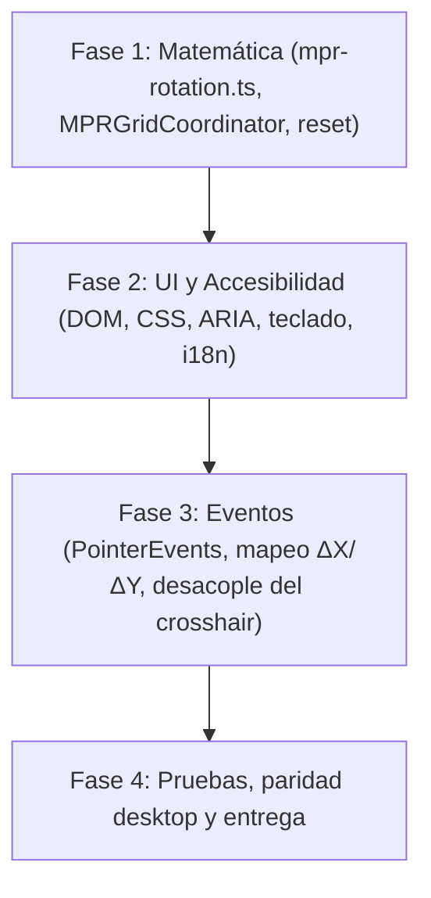

# Plan: [TK-30] Control Trackball MPR (Pitch/Yaw) en la Barra de Herramientas

> **Spec:** `specs/007-mpr-trackball/spec.md` · **Ticket:** TK-30 (Tarea · Prioridad Media · Épica Visualización DICOM) · **Relacionado:** TK-48 / US-50 (`specs/006-mpr-oblique-ux`) · **Date:** 2026-10-12
> **Repos affected:** `web` (authored) · `desktop` (via vendoring en `src/renderer/`)

---

## Summary

Este plan agrega a la barra de herramientas MPR un control tipo **trackball** (esfera virtual) para rotar el triedro de planos oblicuos con precisión sobre dos ejes: el arrastre **horizontal** controla **Yaw** (eje vertical del plano activo) y el arrastre **vertical** controla **Pitch** (eje horizontal). La rotación queda **desacoplada** de la traslación del crosshair: el trackball es la única superficie de rotación angular fina y el arrastre sobre la imagen sólo traslada el crosshair. La solución integra:

1. **Núcleo matemático DOM-free:** composición por cuaterniones y rotaciones incrementales por la fórmula de Rodrigues, con recálculo de normales y reproyección ortonormal, expuesto a través de `MPRGridCoordinator`.
2. **Reset a ejes anatómicos:** retorno a los planos ortogonales Axial/Coronal/Sagital sin alterar posición del crosshair, zoom ni pan.
3. **Lectura angular en pantalla:** Pitch/Yaw derivados de la matriz acumulada (la fuente de verdad **no** son los ángulos, para evitar _gimbal lock_).
4. **UI en DOM puro y CSS sin frameworks**, con roles ARIA, alternativa por teclado al arrastre y contraste no textual WCAG 1.4.11.
5. **Eventos `PointerEvent` aislados** sobre la esfera, con mapeo ΔX/ΔY → ángulos y prevención de conflictos con el crosshair original.

No hay cambios de backend ni de contrato `/api/*`: la feature es 100 % cliente y se hereda en `desktop` por vendoring.

---

## Constitution Check

- **I. Local viewing is free:** la rotación opera íntegramente sobre matrices en memoria del cliente; no requiere sesión, red ni credenciales. ✅
- **II. Plain platform, no new dependencies:** cuaterniones, Rodrigues y Gram-Schmidt en TypeScript puro; la esfera se construye con DOM + CSS (sin Three.js, sin librerías de gizmo, sin canvas/WebGL adicional). **Cero** entradas nuevas en `package.json`. ✅
- **III. Desktop parity by vendoring:** todo el código vive en `web/src`; no se agrega ninguna rama `if (electron)` en archivos de feature. Se re-vendorea con `make sync-web` + `make parity` en el mismo cambio lógico. ✅
- **IV. Bilingual by construction:** todas las cadenas (etiquetas, `aria-label`, `aria-valuetext`, anuncio de reset, tooltip) pasan por `t()` / `data-i18n*`, con claves idénticas en `es.ts` y `en.ts` (`i18n.test.ts` lo garantiza); el readout se re-renderiza en `onLocaleChange`. ✅
- **V. Accessibility (WCAG 2.2 AA):**
  - Alternativa de teclado/un solo puntero al arrastre (**2.5.7 Dragging Movements**) mediante dos `input[type=range]` nativos.
  - Objetivos ≥ 24 px (**2.5.8**), contraste no textual ≥ 3:1 en contorno de esfera, _thumbs_ y foco (**1.4.11**).
  - Un solo tab stop por grupo (`shared/roving.ts`); _live regions_ racionadas (sólo el Reset anuncia). ✅
- **VI. Security:** sin interpolación de datos DICOM ni de usuario en el markup nuevo (los ángulos son `number` y se asignan con `textContent`); sin llamadas a Postgres/Orthanc ni a `/api/*`. ✅
- **VII. Tests where it counts:** matemática pura DOM-free con `tsx --test`; comportamiento DOM con jsdom; deben pasar en `web` y en la copia vendoreada de `desktop`. ✅
- **VIII. Decisions are recorded:** el retiro de la rotación por arrastre de brazos es un cambio de comportamiento de TK-48, resuelto por el Tech Lead y registrado en FR-6 de la spec. No cambia ninguna decisión arquitectónica (ADR) vigente. ✅

No principle is violated; no ADR required.

---

## Existing code to reuse

- `src/viewer/mpr-engine.ts` — `Matrix3.fromRotationAxis(axis, rad)` (Rodrigues, column-major), `Matrix3.multiply`, `Matrix3.isOrthonormal`, `Matrix3.determinant`; `mprEngine.getCamera(plane)` para los ejes del plano activo.
- `src/viewer/mpr-coordinator.ts` — `rotation`, `rotateAroundAxis()`, `setRotation()`, `resetRotation()`, `onRotationChange()` y `syncEngines()`; reutilizar antes que reimplementar el bus de eventos.
- `src/viewer/interaction.ts` — detección de brazos del crosshair (≈L1395-1409) y rotación por arrastre (≈L2138 y ≈L2204); patrón de panel con `pointerdown` + `stopPropagation` (≈L2550) y del gizmo (≈L2665).
- `src/shared/roving.ts` — `initRovingTabindex()`; `src/shared/dom.ts` — helpers `$()`.
- `src/i18n/locales/{es,en}.ts` — claves `viewer.mpr.*` existentes (`layout2x2`, `3d`, …); `data-i18n-attr` para `aria-label`/`title`.

---

## 1. Fase Matemática: Rotación Pitch/Yaw en `MPRGridCoordinator`

### 1.1 Módulo Puro `src/viewer/mpr-rotation.ts` (DOM-free)

| Función                                             | Responsabilidad                                                                      |
| :-------------------------------------------------- | :----------------------------------------------------------------------------------- |
| `quatFromAxisAngle(axis, rad)`                      | $\mathbf{q}=(\cos\frac{\theta}{2},\ \hat{\mathbf{a}}\sin\frac{\theta}{2})$           |
| `quatMultiply(a, b)`, `quatNormalize(q)`            | composición y renormalización                                                        |
| `quatToMatrix3(q)` / `matrix3ToQuat(m)`             | conversión con la misma convención column-major que `Matrix3.fromRotationAxis`       |
| `orthonormalize(m)`                                 | Gram-Schmidt sobre $\mathbf{u},\mathbf{v}$ y $\mathbf{n}=\mathbf{u}\times\mathbf{v}$ |
| `matrixToPitchYaw(m)`                               | lectura angular para la UI                                                           |
| `applyPitchYawDelta(m, uAxis, vAxis, dPitch, dYaw)` | rotación incremental sobre los ejes del plano activo                                 |

### 1.2 Rotación Incremental (Fórmula de Rodrigues)

Para un eje unitario $\hat{\mathbf{k}}$ y un ángulo $\theta$:
$$\mathbf{R}(\hat{\mathbf{k}},\theta)=\mathbf{I}\cos\theta+(1-\cos\theta)\,\hat{\mathbf{k}}\hat{\mathbf{k}}^{\top}+[\hat{\mathbf{k}}]_\times\sin\theta$$

Con $\hat{\mathbf{u}}_a,\hat{\mathbf{v}}_a$ los ejes horizontal y vertical de pantalla del plano activo (en espacio volumen, obtenidos de `mprEngine.getCamera(plane)`):

- **Yaw** (arrastre horizontal): $\hat{\mathbf{k}}=\hat{\mathbf{v}}_a$, $\theta=\Delta yaw$.
- **Pitch** (arrastre vertical): $\hat{\mathbf{k}}=\hat{\mathbf{u}}_a$, $\theta=\Delta pitch$.

$$\mathbf{R}_{new}=\mathbf{R}(\hat{\mathbf{u}}_a,\Delta pitch)\cdot\mathbf{R}(\hat{\mathbf{v}}_a,\Delta yaw)\cdot\mathbf{R}_{old}$$

La rotación gira el **triedro completo** (los tres planos rotan rígidamente), coherente con el modelo global `coordinator.rotation` de US-50; el plano activo sólo define a qué ejes se mapean Pitch y Yaw.

### 1.3 Cuaterniones y Estabilidad Numérica

La acumulación de miles de productos `Matrix3` en `Float32` degrada la ortonormalidad. Estrategia:

1. El coordinador mantiene un cuaternión unitario privado `rotationQuat`, espejo de `rotation`.
2. Cada delta: $\mathbf{q}\leftarrow\operatorname{normalize}(\mathbf{q}_\Delta\otimes\mathbf{q})$ y `rotation ← quatToMatrix3(q)`.
3. Si `setRotation(r)` o un reset externo reemplazan la matriz, `rotationQuat` se re-deriva con `matrix3ToQuat`.
4. Salvaguarda: si `!Matrix3.isOrthonormal(rotation, 1e-4)` tras una operación, se aplica `orthonormalize()`.

### 1.4 Recálculo de Normales y Lectura Pitch/Yaw

- Las columnas de `rotation` son $\mathbf{u}',\mathbf{v}',\mathbf{n}'$ con $\mathbf{n}'=\mathbf{u}'\times\mathbf{v}'$ y $\det=+1$. `syncEngines()` ya propaga a `mprEngine.setRotation()`; un test verifica que las normales de Axial/Coronal/Sagital quedan mutuamente ortogonales.
- **Lectura angular (sólo display).** Descomposición YXZ de la matriz acumulada, con $m_{rc}$ = `out[c*3 + r]`:
  $$pitch=\arcsin(-m_{12}),\qquad yaw=\operatorname{atan2}(m_{02},m_{22}),\qquad roll=\operatorname{atan2}(m_{10},m_{11})$$
  El estado **no** se persiste como ángulos. Con $|pitch|\to 90°$ se clampa y se toma $yaw=\operatorname{atan2}(-m_{20},m_{00})$. Rango mostrado: Pitch $[-90°,90°]$, Yaw $(-180°,180°]$, con redondeo a 0,1°.

### 1.5 Reset a Ejes Anatómicos Ortogonales

`MPRGridCoordinator.resetToOrthogonal()` (reutiliza `resetRotation()` y reinicia `rotationQuat`): `rotation = I`, con normales canónicas
$\mathbf{n}_{axial}=(0,0,1)$, $\mathbf{n}_{coronal}=(0,1,0)$, $\mathbf{n}_{sagital}=(1,0,0)$.
**Conserva** la posición del crosshair, el zoom y el pan, y dispara `notifyRotationListeners()` (el readout vuelve a 0,0°). Es distinto del botón global de reset de vista (`interaction.ts` ≈L195-215), que además reinicia cámaras.

### 1.6 API Nueva en el Coordinador

```typescript
rotatePitchYaw(dPitchRad: number, dYawRad: number, plane: MPRPlane): void;
getPitchYawDegrees(): { pitch: number; yaw: number };
resetToOrthogonal(): void;
```

Los listeners existentes (`onRotationChange`) alimentan el readout; no se agrega un bus de eventos nuevo.

---

## 2. Fase de UI y Accesibilidad

### 2.1 Estructura del DOM (puro, sin framework)

Nuevo `src/viewer/mpr-trackball.ts` (`createMprTrackball(): { el, destroy }`), montado en la barra MPR sólo cuando `state.isMprMode` y el viewport activo **no** es el 3D combinado (`manager.isCombined3DViewport`).

```html
<div class="mpr-trackball" role="group" aria-labelledby="mpr-trackball-label">
  <span id="mpr-trackball-label" data-i18n="viewer.mpr.trackball.label"></span>
  <div class="mpr-trackball-sphere" aria-hidden="true"></div>
  <label>
    <span data-i18n="viewer.mpr.trackball.pitch"></span>
    <input
      type="range"
      class="mpr-trackball-pitch"
      min="-90"
      max="90"
      step="1"
    />
  </label>
  <label>
    <span data-i18n="viewer.mpr.trackball.yaw"></span>
    <input
      type="range"
      class="mpr-trackball-yaw"
      min="-180"
      max="180"
      step="1"
    />
  </label>
  <output class="mpr-trackball-readout" aria-live="off"></output>
  <button
    type="button"
    class="mpr-trackball-reset"
    data-i18n-attr="aria-label:viewer.mpr.trackball.reset; title:viewer.mpr.trackball.reset"
  ></button>
</div>
```

La esfera es sólo superficie de puntero (`aria-hidden`); su alternativa accesible son los dos sliders nativos. Todo texto dinámico se asigna con `textContent`/`valueAsNumber`; nunca `innerHTML` con datos.

### 2.2 CSS sin Frameworks (`src/styles.css`)

- Esfera dibujada sólo con CSS (`border-radius: 50%`, `radial-gradient` para volumen, meridiano/ecuador con `::before`/`::after`); sin imágenes ni SVG externos.
- Contorno de esfera, _thumbs_ y foco con contraste **≥ 3:1** contra el fondo de la barra (**WCAG 1.4.11**); la relación medida (tema claro/oscuro) se registra en el comentario de contraste de `styles.css`, como el resto de los tokens.
- `:focus-visible` con anillo de 2 px ≥ 3:1; estado de arrastre expresado también como `data-dragging="true"` (estado visual ⇒ estado programático).
- Esfera ≥ 64 px; Reset y _thumbs_ ≥ 24×24 px (2.5.8).
- `@media (prefers-reduced-motion: reduce)`: sin transiciones; el Reset es instantáneo. `@media (forced-colors: active)`: bordes con `CanvasText`/`Highlight`.

### 2.3 Roles ARIA y Controles de Teclado

| Elemento         | Semántica                                                                    | Teclado                                                                    |
| :--------------- | :--------------------------------------------------------------------------- | :------------------------------------------------------------------------- |
| Contenedor       | `role="group"` + `aria-labelledby`                                           | **un tab stop** vía `initRovingTabindex` (horizontal): Pitch → Yaw → Reset |
| Slider Pitch/Yaw | `<input type="range">` nativo (rol `slider`) con `aria-valuetext` localizado | ←/↓ −1°, →/↑ +1°, **Shift** ±10°, PgUp/PgDn ±15°, Home/End a extremos      |
| Reset            | `<button>` nativo                                                            | Enter / Espacio → `resetToOrthogonal()`                                    |
| Readout          | `<output aria-live="off">`                                                   | —                                                                          |

- **Live regions racionadas:** no hay anuncio por pixel de arrastre; sólo el Reset anuncia una vez por la región `aria-live="polite"` existente. Los sliders comunican su valor vía `aria-valuetext`.
- Si el viewport activo pasa a 3D combinado, el grupo se oculta (`hidden`) y el foco vuelve al botón MPR previo.

### 2.4 i18n (claves idénticas en `es.ts` y `en.ts`)

`viewer.mpr.trackball.label`, `.pitch`, `.yaw`, `.readout` (`"Pitch {{pitch}}° · Yaw {{yaw}}°"`), `.valueText` (`"{{value}} grados"`), `.reset`, `.resetAnnounce`, `.hint` (tooltip: "Arrastrá para rotar · Shift = fino"). El separador decimal sigue el locale (`Intl.NumberFormat`). El componente se re-renderiza en `onLocaleChange`.

---

## 3. Fase de Eventos: PointerEvents y Desacople del Crosshair

### 3.1 Captura y Máquina de Estados (sobre la esfera)

Los listeners se registran sólo sobre `.mpr-trackball-sphere`; el listener global del canvas **no** se modifica salvo lo indicado en 3.3.

| Evento                                               | Condición                    | Acción                                                                                                                 |
| :--------------------------------------------------- | :--------------------------- | :--------------------------------------------------------------------------------------------------------------------- |
| `pointerdown`                                        | `button === 0` e `isPrimary` | `preventDefault()`, `stopPropagation()`, `setPointerCapture(pointerId)`, guardar `lastX/lastY`, `data-dragging="true"` |
| `pointermove`                                        | `hasPointerCapture`          | acumular `dx`, `dy`; un único render por frame con `requestAnimationFrame` (objetivo 60 FPS)                           |
| `pointerup` / `pointercancel` / `lostpointercapture` | —                            | liberar captura, `data-dragging` removido, volver a `idle`                                                             |

CSS: `touch-action: none` en la esfera para evitar scroll/zoom táctil durante el arrastre.

### 3.2 Mapeo ΔX/ΔY → Ángulos

Arco sobre la esfera de radio $R$ px ($R=$ `sphere.clientWidth / 2`):
$$\Delta yaw=\frac{\Delta x}{R}\cdot g,\qquad \Delta pitch=\frac{\Delta y}{R}\cdot g$$
con ganancia $g=1$ y $g=0{,}1$ con **Shift** (modo fino). Se limita $|\Delta|\le 15°$ por evento para evitar saltos. Convención de signos (cubierta por tests): arrastre a la derecha ⇒ Yaw positivo; arrastre hacia abajo ⇒ Pitch positivo. Cada evento invoca `mprCoordinator.rotatePitchYaw(dPitch, dYaw, activePlane)` y luego `vp.render()` sobre los viewports (mismo patrón que `interaction.ts` ≈L2138).

### 3.3 Prevención de Conflictos con el Crosshair Original

- **Aislamiento:** la esfera vive fuera del canvas y detiene la propagación en `pointerdown` (patrón de `interaction.ts` ≈L2550); ningún `pointermove` del trackball alcanza `setCrosshairFromScreen`.
- **Una sola fuente de rotación angular fina:** se retiran la detección de brazos (≈L1395-1409: `isRotatingMprCrosshair`, `mprRotationPlane`) y las dos ramas de rotación (≈L2138 y ≈L2204). El arrastre izquierdo con la herramienta `crosshair` sólo **traslada** el crosshair. _(FR-6 de la spec.)_
- Mientras hay arrastre del trackball: `state.activeTool` no cambia, el handler de imagen ignora `pointermove` (flag `isTrackballDragging`) y el scroll de cortes no se bloquea.
- **Multi-touch:** sólo se procesa el puntero primario.

---

## Affected files

- `src/viewer/mpr-rotation.ts` (+ `mpr-rotation.test.ts`) — **nuevo**: matemática pura.
- `src/viewer/mpr-coordinator.ts` — `rotatePitchYaw`, `getPitchYawDegrees`, `resetToOrthogonal`, cuaternión espejo.
- `src/viewer/mpr-trackball.ts` (+ `mpr-trackball.test.ts`) — **nuevo**: UI y eventos.
- `src/viewer/interaction.ts` — montaje del trackball; retiro de rotación por brazos; flag `isTrackballDragging`.
- `src/styles.css` — bloque `.mpr-trackball*` y comentario de contraste medido.
- `src/i18n/locales/es.ts`, `src/i18n/locales/en.ts` — claves `viewer.mpr.trackball.*` (idénticas).
- `src/viewer/mpr-coordinator.test.ts`, `src/viewer/interaction.test.ts` — casos nuevos y ajustes.
- `specs/007-mpr-trackball/007-mpr-trackball.feature` — acceptance Gherkin.

---

## 4. Fases de Implementación y Plan de Pruebas



### Testing strategy

1. **Unit (`tsx --test`, DOM-free):** Rodrigues idéntico a `Matrix3.fromRotationAxis`; $\mathbf{R}(\theta)\cdot\mathbf{R}(-\theta)=\mathbf{I}$; Yaw de 90° sobre Axial ⇒ normal igual a Sagital; `isOrthonormal` tras 10 000 deltas aleatorios; round-trip `matrix ↔ quat`; `matrixToPitchYaw` recupera $(p, y)$ incl. cerca de ±90°; `resetToOrthogonal()` ⇒ identidad con normales canónicas y crosshair intacto.
2. **DOM / integración (jsdom):** arrastre con `PointerEvent` (`setPointerCapture` stubbeado) invoca `rotatePitchYaw` con el signo y la ganancia esperados; Shift reduce la ganancia; `pointercancel` termina el arrastre; `pointerdown` del trackball **no** invoca `setCrosshairFromScreen`; teclado en sliders (±1/±10/±15); Reset anuncia una sola vez; paridad de claves ES/EN; el readout cambia con el locale.
3. **Manual / BDD:** `007-mpr-trackball.feature` — rotar Yaw/Pitch, modo fino con Shift, Reset a ortogonales, el arrastre sobre la imagen sólo mueve el crosshair, uso sólo con teclado, contraste y foco visibles en ambos temas.

---

## Desktop parity steps

`web` green → in `desktop/` (`MICD_APP`): `make sync-web` → `make parity` (must match) → `npm run build` → `npm test`. Verificar manualmente `PointerEvent` + `setPointerCapture` bajo Electron (mismo motor Chromium, sin seam adicional).

## Rollout / delivery

- Rama de trabajo actual: `feat/rotator-tools` (web + desktop).
- Commit order: spec 007 → Fase 1 (math) → Fase 2 (UI) → Fase 3 (eventos) → paridad desktop. Commit web antes de sincronizar desktop para que `.web-sync` registre el commit correcto.
- Verify: `npm run build` + `npm test` + `pre-commit run --all-files` + `make parity`; sin migraciones ni cambios de backend.

---

## Open questions

Ninguna pendiente. Resueltas por el Tech Lead el 2026-10-12:

1. **Brazos del crosshair:** la rotación por arrastre de los brazos **se elimina**; el trackball es la única fuente de rotación angular (FR-6). Implementado en la Sección 3.3.
2. **Alcance de Pitch/Yaw:** se rota el **triedro completo** alrededor de los ejes del plano activo (FR-2). Implementado en la Sección 1.2.
3. **Ticket:** asignado **TK-30** (tablero, 2026-10-12).
